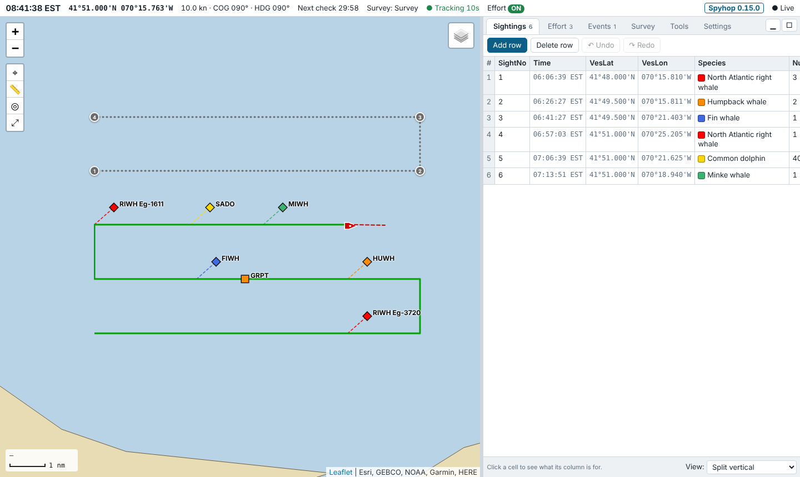

# Spyhop

Spyhop is a python-based data recorder for marine mammal surveys. It reads GPS and instruments over NMEA 0183, shows a live chart, and logs **sightings, effort and environmental conditions, events, the trackline and instrument readings and more** to plain CSV files as you type. It also has some handy features for survey planning, error checking, and reporting. Best of all, it's totally free, open source, runs on any laptop (Mac, Windows or Linux) and needs no internet once installed.

> **Active development.** Spyhop is developed for our own vessel-based whale surveys at the New England Aquarium, and its default lists, checks and reports follow our protocols. Other groups are welcome to use and adapt it: lists, shortcuts and reports are config files, not code. Expect changes between versions, and check the exported columns against your own pipelines before relying on them. Version: see [CHANGELOG.md](CHANGELOG.md) (also shown in Spyhop under Survey → About).

## Features

- **Data entry built for the flying bridge:**
  - Sightings, Effort and Events tables with drop-downs that filter as you type
  - keyboard shortcuts, including species shortcuts
  - time and position filled from the GPS, copy-forward of conditions, per-table undo/redo
- **Live chart:**
  - vessel, trackline (on and off effort), sightings worked out from bearing and distance, events and waypoints
  - measure tool, range rings, imported overlays (GeoJSON, GPX, KML), and past surveys as overlays
  - offline coastline, online base maps with a tile cache, and NOAA MBTiles charts offline
- **Route planning:**
  - manual or systematic (parallel-leg) tracklines, with leg times at the survey speed
  - activate a route to keep it on the chart
  - GPX export and import
- **GPS and instruments:**
  - serial/USB, UDP, TCP, gpsd and file replay, with priorities between inputs
  - depth, wind, weather and engine readings with time-series plots
  - raw NMEA logging, and a built-in **simulator** for practice
- **Survey management:**
  - Start, End and Close; crash recovery that asks to continue the survey
  - keeps the computer from going to sleep during a survey (optional)
  - survey details (platform, organization, chief scientist)
  - a clock in local time, UTC, any offset, or the zone at the vessel's position
- **Quality control:**
  - required fields, list values, plausible numbers and bearings
  - positions on land, sightings beyond the visibility, GPS jumps and gaps (with a one-click Fix), observer rules, and more
- **Reports:**
  - a Summary (totals, conditions, observers, a map)
  - tables of gear, dead birds, right whales and blue whales
  - saved as HTML or PDF
  - reports are JSON definitions that each group can add to or change
- **Group config:** a team keeps its lists, shortcuts, map settings and report templates in one place on the web (e.g. GitHub, Dropbox or Google Drive), and each computer pulls the latest with one button, keeping a backup.
- **Export:** separate CSVs, a merged time-ordered CSV (sightings, effort, events and track) with the conditions on every row, GPX, GeoJSON, and the reports, in one zip.

## System requirements

- **Operating system:** macOS 12 (Monterey) or newer, on Apple silicon or Intel; or Windows 10 or 11 (64-bit). Linux works too.
- **Python:** 3.10 or newer, from [python.org](https://www.python.org/downloads/).
- **Browser:** Google Chrome or Microsoft Edge are recommended. Spyhop opens in a Chrome/Edge "app" window, and they're needed for saving reports as PDF. Without either, Spyhop opens in your default browser.
- **Internet:** once, the first time Spyhop starts (and after an update that adds packages), to install its Python packages. It's not needed after that.
- **Disk:** roughly 100 MB with its Python packages, plus your data and any offline charts.
- **Screen:** 1280 × 800 or larger is comfortable.
- **GPS:** any NMEA 0183 source: a USB GPS, or a ship's network sending NMEA over UDP or TCP. You don't need one to try Spyhop: use the simulator.

## Installation

### Mac

1. Install **Python 3.10 or newer** from [python.org](https://www.python.org/downloads/macos/). Use the installer: the `python3` that comes with Apple's developer tools is too old on many Macs.
2. Download Spyhop from the [latest release](https://github.com/hansenjohnson/spyhop/releases/latest): under **Assets**, click **Source code (zip)**. Unzip it.
   - **Rename the folder** from `spyhop-0.9.2` (or similar) to `spyhop`. In-app updates replace the files in place, so the folder keeps its name; a version number in it would soon be wrong.
   - Put the folder where it will stay, e.g. in Documents, **before** the first start: the Spyhop icon points at this folder.
   - Developers can `git clone https://github.com/hansenjohnson/spyhop.git` instead. Spyhop then updates itself with `git pull`.
3. Double-click **`Start Spyhop (Mac).command`**.
   - macOS blocks it the first time because it was downloaded. Open **System Settings → Privacy & Security**, scroll down, click **Open Anyway** next to the message about it, then double-click the file again.
   - On older macOS: right-click it, choose **Open**, then **Open**.
4. The first start takes a minute: it sets up a private Python environment in `.venv` (it needs internet) and adds a **Spyhop** icon to **Applications** and the **Desktop**. Drag the icon to the Dock to keep it handy.

### Windows

1. Install **Python 3.10 or newer** from [python.org](https://www.python.org/downloads/windows/). In the installer, tick **Add python.exe to PATH**.
2. Download Spyhop from the [latest release](https://github.com/hansenjohnson/spyhop/releases/latest): under **Assets**, click **Source code (zip)**. Unzip it (right-click → **Extract All…**).
   - **Rename the folder** from `spyhop-0.9.2` (or similar) to `spyhop`. In-app updates replace the files in place, so the folder keeps its name; a version number in it would soon be wrong.
   - Windows often unzips into a folder inside a folder of the same name (`spyhop-0.9.2\spyhop-0.9.2`). Use the inner one, which contains `README.md` and the start files.
   - Put the folder where it will stay, e.g. in Documents, **before** the first start: the Spyhop icon points at this folder.
   - Developers can `git clone https://github.com/hansenjohnson/spyhop.git` instead. Spyhop then updates itself with `git pull`.
3. Double-click **`Start Spyhop (Windows).bat`**. If Windows says it protected your PC, click **More info → Run anyway**.
4. The first start takes a minute: it sets up a private Python environment in `.venv` (it needs internet) and adds a **Spyhop** icon to the **Desktop** and the **Start menu**. Right-click the icon to pin it to the taskbar.

### Linux

Download and unzip the [latest release](https://github.com/hansenjohnson/spyhop/releases/latest) (or `git clone` the repository), rename the folder to `spyhop`, put it where it will stay, then run `./start-spyhop.sh` in it. It also adds Spyhop to the applications menu.

### Starting, quitting and updating

- **Start Spyhop with its icon.** It opens a Terminal (or console) window, which *is* Spyhop running, and then Spyhop's own window. **Keep the Terminal window open while you work.**
- **To quit,** close the Terminal window, or press Ctrl+C in it. Everything is saved as you type, so quitting never loses data.
- **To update,** open **Survey → About → Updates**, press **Check for updates**, then **Install**, and restart Spyhop when it asks.
  - It needs internet, and it updates from this repository's latest release (or its main branch, before the first release).
  - It keeps a backup of the old version and never touches your data.
  - You can also replace the program files by hand, or run `git pull` if you cloned the repository.
  - Your lists, settings and surveys live in Spyhop's own folder, not in the program folder, so they carry over:
  - **Mac:** `~/Library/Application Support/Spyhop`
  - **Windows:** `%APPDATA%\Spyhop`
- If you move or rename the program folder later, double-click the start file in its new place once to update the icon.

## Starting a survey

1. **Connect the GPS.** In **Survey → NMEA**, under *GPS / NMEA inputs*, press **+ Add input** and choose its type:
   - **SERIAL** for a USB GPS (pick its port)
   - **UDP** or **TCP** for a ship's network
   - **SIMULATOR** to practise
   
   Press **Apply**. The status bar shows the position once there's a fix.
2. **Check your lists** (once): **Survey → Settings → Config files** opens species, observers, event types, behaviours and shortcuts in your spreadsheet program. Save, then press **Reload config files**.
3. **Plan the route** (optional): **Survey → Route**, then **Activate route**.
4. **Start:** in **Survey → File**, press **Start New Survey…**. Enter a name (in your team's own naming convention) and the survey details. Spyhop adds the *Start* row to Effort and starts the trackline.
5. **Go on effort:** Ctrl+Shift+F (⌘⇧F on a Mac) adds an Effort row that switches effort ON or OFF. Fill in the conditions and the observers.
6. **Record sightings and events:** press **Add row** in the Sightings or Events tab, use a shortcut (Ctrl/⌘+Shift+S for a sighting, Ctrl/⌘+Shift+V for an event), or right-click the map.
7. **Finish:** **Survey → Quality Control → Run quality control check**, then **Survey → File → End Survey…** and **Export Data…**.

The **tutorial** in **Survey → About** (also [docs/TUTORIAL.md](docs/TUTORIAL.md)) walks through all of this, including the simulator, config files, error checking and reports.

## Documentation

- [docs/TUTORIAL.md](docs/TUTORIAL.md): a short tour of the main tasks.
- [docs/USER_GUIDE.md](docs/USER_GUIDE.md): the full reference, covering every tab, the files Spyhop writes, export formats, offline maps, and the differences from the OpenCPN plugin.
- [spyhop/report_defs/README.md](spyhop/report_defs/README.md): writing your own reports.
- [docs/CONFIG_PACKS.md](docs/CONFIG_PACKS.md): sharing config files and report templates across a team.
- [docs/DEVELOPERS.md](docs/DEVELOPERS.md): running from source, the code layout and the tests.
- [CHANGELOG.md](CHANGELOG.md): what changed in each version.

## Feedback

Please report problems and suggestions as GitHub issues. For a bug, **Survey → About → Save diagnostics…** makes a zip of Spyhop's logs and settings (no survey data and no team names) that you can attach.

## License

Spyhop is free software, released under the [GNU General Public License v3.0 or later](LICENSE). You can use, share and change it; if you distribute a modified version, it must also be under the GPL, with its source code available.
